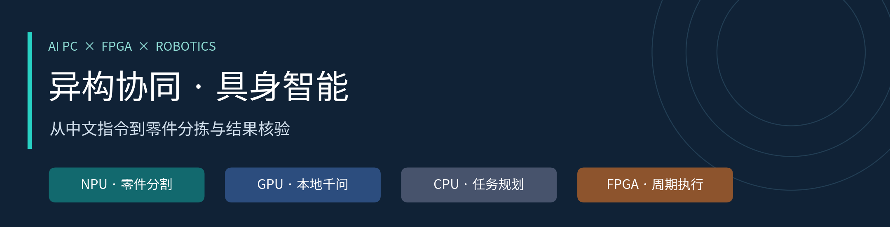
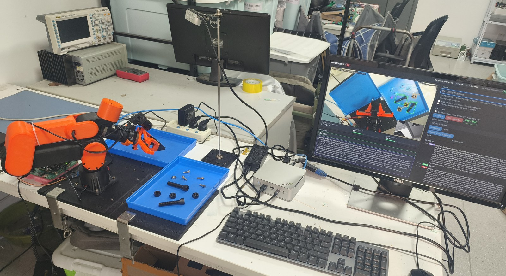
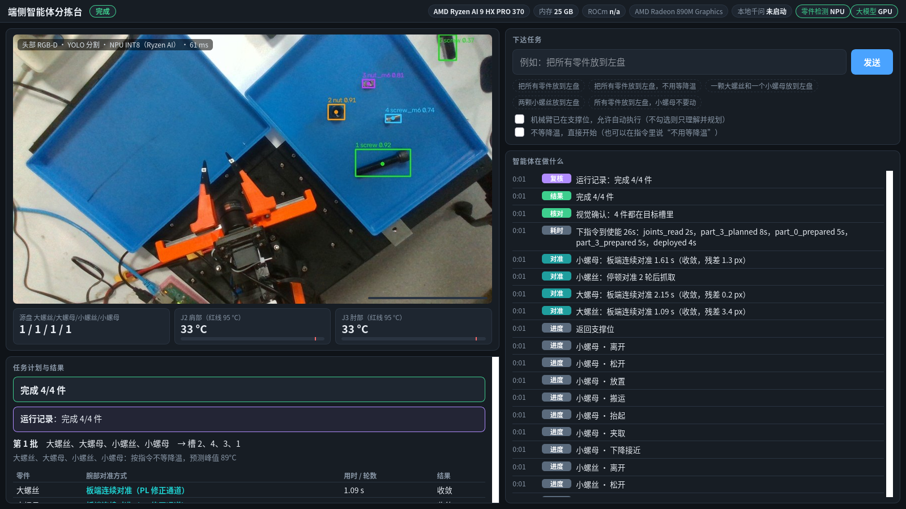
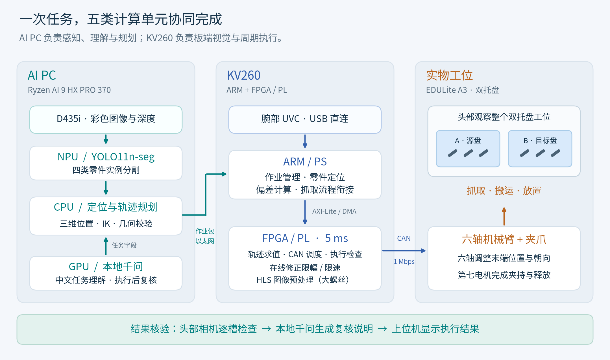
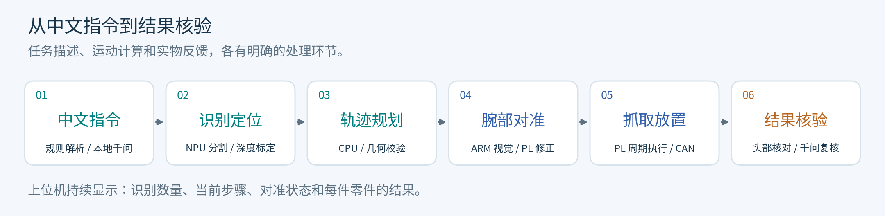

# 异构协同具身智能机械臂控制系统



**输入中文任务，完成零件识别、轨迹规划、抓取放置与结果核验。**

[技术报告](report/tech_doc.pdf) · [系统架构](report/docs/architecture.md) · [实测数据](metrics/metrics.csv) · [复现指南](report/docs/reproduce.md) · [技能包](skill/README.md)

2026 全国大学生嵌入式芯片与系统设计竞赛 · FPGA 创新设计赛道 · AMD 具身智能方向

## 项目做什么

我们用一台 Ryzen AI PC、一块 Kria KV260 和 EDULite A3 六轴机械臂，搭建了双托盘零件分拣工位。头部相机寻找目标，腕部相机在接近零件后修正局部偏差。机械臂完成放置后，系统用头部相机核对结果，再由本地千问模型生成中文复核说明。

例如，输入“把大螺丝、大螺母和小螺丝放到左盘”，系统会按类别选择目标并执行任务；输入“只把小螺母放到左盘”，则保留其他类别。上位机同时显示检测数量、任务步骤、对准进度与每件零件的执行结果。

| 工位实拍 | 上位机与四类零件识别 |
|:---:|:---:|
|  |  |

| 功能 | 系统如何完成 |
|---|---|
| 四类零件分拣 | YOLO11n-seg 区分 M12 大螺丝、大螺母和 M6 小螺丝、小螺母；结合深度与标定计算抓取位置和方向。 |
| 中文任务理解 | 常见表达由规则解析，其他表达交给本地千问模型；统一校验类别、数量和目标托盘。 |
| 近距离对准 | 腕部相机观察零件，板端计算偏差并通过 PL 修正通道调整末端，再衔接抓取。 |
| 结果核验 | 头部相机逐槽核对；本地大模型结合图像和运行记录，说明完成情况。 |
| 零重力示教 | 根据实测关节姿态补偿重力，支持手动拖动、姿态与轨迹记录，数字孪生同步显示反馈。 |

## AI 与 FPGA 分别做什么



| 计算单元 | 具体任务 |
|---|---|
| **AI PC · NPU** | 运行四类零件实例分割模型，持续提供目标轮廓。 |
| **AI PC · GPU** | 运行本地 Qwen2.5-VL-3B，处理需要模型理解的中文指令，并在任务结束后生成复核说明。ROCm 也用于模型训练。 |
| **AI PC · CPU** | 结合深度与标定计算目标位置，求解逆运动学、生成轨迹并做几何校验。 |
| **KV260 · ARM** | 校验和管理作业，获取腕部图像，计算零件位置与修正量，衔接对准、抓取和放置。 |
| **KV260 · FPGA / PL** | 每 5 ms 求值轨迹并调度 CAN 设定；执行租约、范围和反馈检查；对视觉修正限幅限速；加速大螺丝的图像掩码预处理。 |

大螺丝、大螺母和小螺母采用板端连续对准；小螺丝采用多帧停顿对准。PL 图像核服务于大螺丝掩码处理，其余类别由板端 ARM 运行对应的定位算法。具体流程见[连续对准说明](report/docs/continuous_alignment.md)。

## 从指令到实物的流程



大模型输出类别、数量和目标托盘等任务字段。坐标、关节设定和运动保护由几何计算、规划程序及板端控制完成。执行结束后的大模型复核用于说明结果，数量以检测与逐槽核验为依据。

## 实测结果

| 指标 | 结果 | 测量条件与证据 |
|---|---|---|
| CAN 设定周期偏差 | **中位数 0.4 µs** | 名义周期 5 ms，逻辑分析仪记录 15364 个周期。[时序数据](metrics/logs/bus_timing.json) |
| 大模型同载下的检测延迟 | **NPU P95 141 ms**；GPU P95 306 ms | 本地 Qwen2.5-VL 连续生成期间，同条件对照。[检测说明](report/docs/npu_detector.md) |
| PL 图像预处理 | **中位数 7.82 ms**；ARM 单核 14.43 ms | 300 帧，包含 DMA 与缓存维护。[原始数据](metrics/logs/board_bench_20261028.json) |
| 图像预处理的 CPU 每帧耗时 | **0.68 ms**；ARM 方案 14.45 ms | CPU 每帧耗时降低 95%，用于减轻板端处理器负担。 |
| 板端连续对准 | **1.06 / 2.43 / 1.61 s** | 依次为大螺丝、大螺母、小螺母；悬停到收敛的中位时间。[逐类统计](report/docs/continuous_alignment.md) |
| FPGA 实现 | **100 MHz；WNS +0.150 ns** | LUT 61.51%、FF 30.00%、BRAM 5.21%、DSP 33.25%。[实现报告](build/report/impl_utilization.rpt) |

完整测量条件与结果见[指标表](metrics/metrics.csv)。检测模型的精度、版本与权重摘要见[模型说明](data/model/MODEL.md)。

## 如何阅读与复现

只看项目方案，可先阅读[技术报告](report/tech_doc.pdf)和[设计说明](report/design_report.md)；查看数据，可从 `metrics/logs/` 与 `metrics/scripts/` 开始。目录按选题指南推荐结构组织：

```text
edulite_a3_kv260_sorting/
├── README.md
├── src/        # FPGA RTL / HLS，以及 AI PC 软件
├── sim/        # 16 个 RTL 测试平台与回归入口
├── build/      # 构建入口、源码归档、位流与实现报告
├── board/      # KV260 ARM 运行时、视觉与寄存器驱动
├── data/       # 模型权重、量化模型与参考配置
├── metrics/    # 赛道指标表、原始数据和分析脚本
├── skill/      # 5 项开发与复用工作流
└── report/     # 技术报告、图表、接口说明与视频材料
```

### FPGA 构建与仿真

在仓库根目录执行。校验源码归档只需要 Python 3；仿真和建工程需要 Vivado 2025.2。

```bash
python3 build/scripts/rebuild.py check

# 按实际安装位置填写
export XILINX_SETTINGS64=/path/to/Vivado/2025.2/settings64.sh
python3 sim/run_tests.py
bash build/scripts/build_can.sh create
```

提交包已在独立目录完成工程创建和 **16 项 XSim RTL 回归**。继续生成位流与部署包的步骤见 [KV260 工作流](skill/kv260_pl_workcell_ops/README.md)，验证记录见 [构建检查](build/report/portable_rebuild_validation.json)。

### 上位机与实物工位

上位机需要配置 Python 隔离环境、本地大模型、板卡 SSH 连接和当前工位标定。按[复现指南](report/docs/reproduce.md)准备，先完成离线环境检查，再连接相机和机械臂。示例指令使用“把大螺丝放到左盘”；控制台在操作员确认承托位置后才进入实物执行。

<details>
<summary>实验环境与硬件版本</summary>

| 部分 | 配置 |
|---|---|
| AI PC | Ryzen AI 9 HX PRO 370 · Radeon 890M · XDNA2 NPU |
| GPU 环境 | ROCm 7.14.1 · PyTorch 2.12.0+rocm7.14.1 |
| NPU 环境 | Ryzen AI Software 1.8.0 · AMD Quark 0.12 · VitisAI EP |
| 控制板 | Kria KV260 / K26 SOM · Vivado / Vitis HLS 2025.2 |
| 机械臂 | EDULite A3 六轴 + 夹爪，CAN 1 Mbps |
| 相机 | 头部 D435i 接 AI PC；腕部 UVC 接 KV260 |

接线与安装见[硬件说明](report/docs/hardware_setup.md)。

</details>

## 文档导航

- [系统架构](report/docs/architecture.md) · [接口与协议](report/docs/interface.md) · [板端连续对准](report/docs/continuous_alignment.md)
- [NPU 检测](report/docs/npu_detector.md) · [本地千问与结果复核](report/docs/vlm_review.md) · [评分项与证据](report/docs/scoring_map.md)
- [技能包](skill/README.md) · [大模型协作记录](report/llm_collaboration.md) · [视频旁白与剪辑安排](report/video/narration_3min.txt)
