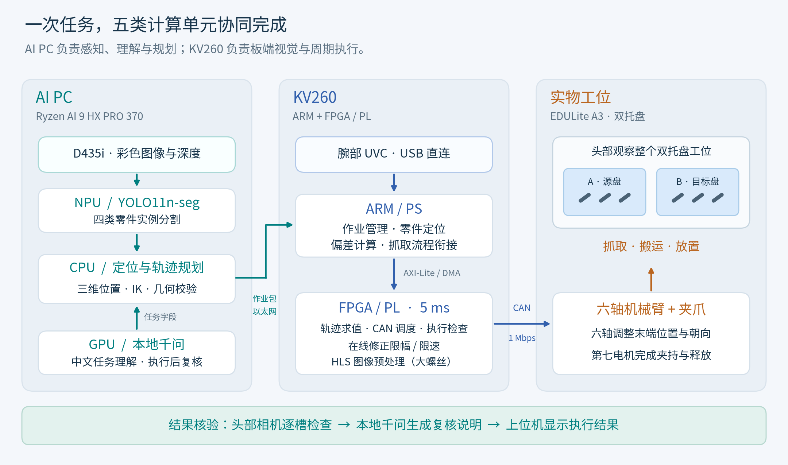

# 系统架构与数据流

系统围绕“中文任务 → 零件定位 → 运动执行 → 结果核验”运行。AI PC 负责模型推理与规划，KV260 负责腕部视觉和周期控制。下图列出主要计算分工。

## 一次任务的数据流

1. **理解任务。** 上位机接收中文指令，经规则或本地千问解析为类别、数量和目标托盘，再统一校验字段。
2. **定位目标。** D435i 的彩色图像进入 NPU 上的 YOLO11n-seg；CPU 将分割轮廓、深度和标定结果结合，计算目标位置与抓取方向。
3. **准备运动。** CPU 完成逆运动学、轨迹生成和几何校验，将带摘要的作业包经以太网下发到 KV260。
4. **腕部对准。** ARM 获取近距离图像、计算局部偏差。连续对准时，修正目标写入 PL 通道，按每关节限幅和步长施加到轨迹设定上。
5. **抓取与放置。** PL 每 5 ms 求值轨迹，调度七个电机的 CAN 设定，并接收电机反馈。ARM 管理执行阶段与异常处理。
6. **核验结果。** 放置后，头部相机逐槽检查；本地千问依据图像与运行记录生成说明，上位机展示结果。

## 两种腕部对准路径

| 零件 | 图像处理 | 纠偏路径 |
|---|---|---|
| 大螺丝 M12 | PL 加速掩码预处理，ARM 计算中心和主轴 | 板端连续对准，视觉环直接更新 PL 修正目标。 |
| 大螺母 M12、小螺母 M6 | ARM 运行相应的 OpenCV 定位算法 | 板端连续对准。 |
| 小螺丝 M6 | 多帧图像与头端判断 | 停顿取图，由 AI PC 计算修正或抓取段，板端校验后执行。 |

连续对准的图像处理和修正更新都在 KV260 内完成。详细控制律、收敛条件和数据见 [连续对准说明](continuous_alignment.md)。

## FPGA 内部模块

以下源码路径相对仓库根目录。

| 模块 | 作用 |
|---|---|
| `can_engine` | CAN 收发、反馈表、截止期队列、租约与反馈新鲜度检查。 |
| `trajectory_stream` + HLS `trajectory_eval` | 七次多项式求值、CSP 位置设定及六关节在线修正。 |
| `tracking_monitor` | 被动观察设定帧和反馈帧，逐轴记录位置与力矩偏差；该监视模块本身不直接停止电机。 |
| HLS `vision_pre` | 指尖区域填充、11 抽头高斯、ROI 内 Otsu 阈值和 7×7 闭运算，通过 DMA 读帧、写掩码。 |
| `mit_trajectory_stream` | MIT 模式的轨迹执行路径，用于重力补偿等控制场景。 |

`fk_batch` 是另外提供源码及验证记录的正运动学 HLS IP，本次用于分拣的合并位流没有实例化它。当前分拣位流的 PL 资源与时序见 `build/report/`：100 MHz，WNS +0.150 ns。

## 为什么这样分工

NPU 承担常驻检测，GPU 为大模型推理提供算力，减少两项任务同时使用 GPU 时的资源竞争。CPU 适合处理坐标变换、规划和任务逻辑。

PL 使用硬件时基调度电机设定，承担范围、租约和反馈检查；ARM 管理图像定位和执行流程。大螺丝掩码预处理经 PL 加速后，300 帧测试的耗时中位数为 7.82 ms，CPU 每帧耗时从 14.45 ms 降至 0.68 ms。

## 执行与停止

正常返回承托起点、反馈确认后结束本轮使能。中途悬空或故障保持时，等待操作员承托并确认后再结束使能。寄存器、故障码与具体动作见 [接口说明](interface.md)。
